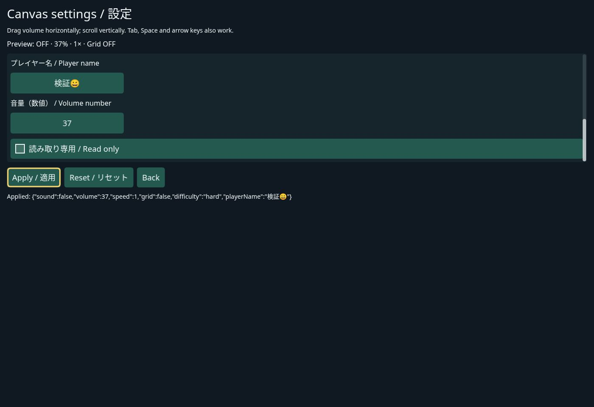

# Canvas Select and native text editing

Current status: complete for the tested Chromium scope. All three controls are integrated by PR #4 as 884475b; main CI passed 696 unit / 294 browser tests and Pages deployment. Public Settings lab and the editing guide were verified against that source. Real OS Japanese IME and physical mobile keyboards remain unverified.

## Baseline and recovery

- Baseline main: `c7a3fbc18e340470e422acc43a662e3de900c0a8` (previous controls merge `ff39721`).
- Work branch: `feat/canvas-native-input-2026-10-31`.
- Baseline [CI 41178455505](https://github.com/oz-coden/Simpludify/actions/runs/41178455505) succeeded with 658 unit / 266 browser tests and Pages deployment. No new verification has run at this checkpoint.
- Read contributor instructions, architecture/API, existing controls, scrolling/focus/routing, native keyboard mirrors, browser gameplay exclusion and `text-input-design.md` before implementation.

## Design decisions

- Reuse CanvasInputNode values/events, CanvasUI focus/traversal/reveal, existing pointer routing and Host presentation lifetime. Core must remain DOM/Pixi-free.
- Select uses typed copied options with separate labels and values. A native Host single-choice element supplies browser/OS popup, scrolling, disabled options and viewport placement, escaping Canvas ancestor masks. No custom window manager. Core owns accepted value and cancellable selection sessions; Host owns native popup UI. Exact popup keyboard conventions remain platform-specific.
- A narrow, generation-checked native editing port will carry full draft/UTF-16 selection/composition snapshots, never physical-key text reconstruction. Native editors own caret/selection/clipboard/grapheme movement and IME painting; Pixi paints inactive text and the control background. One editor must never paint over a second independent Canvas caret.
- Accepted values and drafts are separate: text and number publish accepted changes on valid commit; intermediate/composing drafts have their own typed notification. Escape cancels a draft; blur commits a noncomposing valid draft, while composition/lifecycle/program supersession cancels. Program commands invalidate sessions even for equal writes.
- NumberInput reuses finite Slider range/step normalization and the same native text session, preserving incomplete numeric drafts until commit. Invalid numeric commit restores accepted text and sends cancellation; no NaN/Infinity state.
- Native activation is synchronous from the actual native pointer target. Text-selection gestures belong to the editor, while wheel scrolling and existing Canvas/Slider gestures retain the shared route. Native bounds/clip/typography follow UI geometry and scale.
- Tests will distinguish actual browser editing from synthetic composition and unverified OS IME/mobile behavior. Windows/macOS Japanese IME and physical mobile keyboards are unavailable here and will not be claimed verified.

## Initial progress and remaining work

Initial investigation/design complete. Select, text session, TextInput, NumberInput, sample/docs, regression tests, review, PR/main integration and Pages verification remain pending. No unfinished factory has been added.

## Select checkpoint

- Implemented copied typed options, label/value separation, program/options replacement, disabled options, read-only, accepted change/commit/cancel transactions and stale-session rejection. Empty options have undefined value; missing values fall back predictably; duplicate values are rejected.
- Added a narrow native session/port shape and native single-choice Host presentation. Native browser/OS popup handles option scrolling, edge placement and escape from Canvas clips. Existing CanvasUI traversal/blur and CanvasInputNode events are reused.
- Focused Core verification: **46 passed / 0 failed** across new Select cases and existing control cases. TypeScript passes after correcting the test Scene fixture to provide its required ID. Browser execution is pending; local pinned Chromium download returns a truncated/non-ZIP archive. No native popup or IME certification yet.
- Shell git push cannot authenticate; checkpoints use the connected GitHub tree/commit/ref API with normal fast-forward updates and expected-head checks. Initial remote design commit: [5678c02](https://github.com/oz-coden/Simpludify/commit/5678c029075f60b2dd0ba9ab99de9df53f2617cb).
- Next: harden Host generation replacement, implement native text snapshots/drafts and TextInput/NumberInput, add browser regressions and sample/docs.

## Native text contract checkpoint

- Select implementation saved remotely as [da83240](https://github.com/oz-coden/Simpludify/commit/da8324039bd392dc80605aceb318fd1e5332706d).
- Added a shared Core text editor abstraction carrying immutable single-line draft/UTF-16 selection/direction/composition snapshots and typed draft notifications. Accepted values remain separate; sessions have monotonic identities, generation/availability checks, explicit commit/cancel, blur policy and disposal invalidation.
- Existing value foundation now retains the actual activation source for edit-end events. Slider's immediate-value behavior remains unchanged. Numeric range normalization was named/exported for reuse; DOM-free compilation and all existing focused control cases still pass.
- TypeScript compilation passed for this contract checkpoint. Concrete TextInput/NumberInput and Web text adapter/tests remain pending. Actual OS IME is unverified.

## TextInput checkpoint

- Shared text contract saved as [2901301](https://github.com/oz-coden/Simpludify/commit/29013011e210ce856ff2c0771a7afc5cf83b8004).
- Added CanvasTextInput with accepted values, immutable drafts/selection/composition, placeholder, validated native UTF-16 maxLength, program replacement, read-only/disabled cancellation, Enter/blur acceptance and Escape rollback. Native focused input supplies browser caret/selection/clipboard/grapheme handling; inactive text remains Canvas-painted.
- Host surfaces are bound to the Core control revision and replaced on program/options/read-only changes. Detached editor callbacks cannot begin sessions on another generation. Native pointer focus is synchronous; editor gestures are distinct from Canvas drags. Shared CanvasUI handles Tab/reveal; wheel input reaches existing Core scroll routing.
- Focused Core suites: **58 passed / 0 failed**. TypeScript passed. The new reentrant-change test was corrected to expect the existing EventBus recursive-delivery diagnostic while verifying program replacement wins and stale commit is suppressed; existing behavior/assertions were retained.
- Local Chromium installation failed after all download attempts (invalid/truncated ZIP). Browser caret/clipboard/IME adapter cases are not yet executed. NumberInput, browser regressions, sample/docs and full CI remain pending.

## NumberInput checkpoint

- TextInput implementation saved as [78a0998](https://github.com/oz-coden/Simpludify/commit/78a09987b1575356f153e4cad3714adf0cb78d7d).
- Added CanvasNumberInput using shared text editing and Slider's finite range/step normalization. Decimal/exponent parsing is locale-independent; empty/sign/dot/partial-exponent/nonfinite drafts remain editable but cancel on invalid commit. Arrow/Page keys step finite accepted values and do not interfere with composition.
- Dynamic range changes validate first and supersede drafts; native text presentation exposes spinbutton semantics. Slider/NumberInput can share state using onChange with equality guards before reflected program writes.
- TypeScript passed; focused suites **71 passed / 0 failed**. Added disposal cleanup aggregation and a single presentation-owned window/visibility interruption listener. These last lifecycle changes still need browser regression execution.
- Next: Settings lab, browser WebGL/Canvas2D desktop/narrow cases, docs, full checks/CI and review. Actual OS IME/physical soft keyboards remain unverified.

## Sample, documentation and browser regression checkpoint

- NumberInput implementation saved as [fb87b99](https://github.com/oz-coden/Simpludify/commit/fb87b991bec244f9d25756969baaaa5a0bd897c4).
- Settings lab now includes typed difficulty Select, player-name TextInput, synchronized numeric volume and existing Checkbox/Slider/Apply/Reset/read-only/scroll composition. Definitions import Core only; subscriptions are root-scoped. Existing exact snapshot assertions include the newly implemented settings.
- Added WebGL/Canvas2D × desktop/narrow browser cases for native options/keys, Unicode editing/caret/selection, real browser clipboard shortcuts, composition-event ordering, detached editor rejection, invalid number drafts/keys, native drag ownership/wheel/clipping and Scene cleanup. These are not OS IME tests; execution is pending candidate Actions.
- Complete local unit suite: **693 passed / 49 files / 0 failed**, 3.73s. Earlier sample snapshot expectation failed solely because it omitted the new fields; the expectation now checks those fields too. No existing regression assertion was removed. TypeScript compilation passes with new fixtures.
- Updated English editing guide, API, Host/architecture/roadmap, Japanese Canvas entry, sample README and site page title. The guide specifies accepted/draft semantics, typed options, native presentation, UTF-16/maxLength, locale-independent numbers, shared Slider values, Host migration and physical IME/mobile/AT limits.
- Save before full static/build/site/CI review. Local Chromium remains unavailable; exact-source Actions must pass before integration.

## Final review checkpoint before candidate CI

- Sample/docs/browser checkpoint: [8f89c3a](https://github.com/oz-coden/Simpludify/commit/8f89c3a2372aac46551a6752c84b57add78381a2), [CI 41181647839](https://github.com/oz-coden/Simpludify/actions/runs/41181647839). Quality identified three formatting/export-order errors in the new guide/index/exports; these are corrected. Production job succeeded; browser/site jobs are still running at this receipt. This intermediate run is not accepted as full success.
- `npm run check`: passed after those formatting corrections; baseline **12 warnings / 11 infos** unchanged. DOM-free Core, module/required-file/license checks passed with no new dependency.
- `npm test`: **695 passed / 49 files / 0 failed**, 3.47s. Added reentrant blur/focus redirection and observer-error cancellation tests. Text snapshot deduplication now compares fields directly rather than allocating JSON strings.
- `npm run build -- --target web`: passed. Project and root site build/check passed independently, each **62 HTML / 3972 references / 58 typed snippets**. Browser enumeration at the first sample checkpoint was 286 cases; an additional lifecycle/scale/dynamic-options case for both renderers/viewport projects is now included (execution pending).
- Final review examined Core/Host imports, accepted/draft semantics, finite range policy, revision-based program supersession, reentrant focus redirection, native element removal, listener ownership, pointer/editor versus parent scroll routing, composition boundaries and plain-language public documentation. No existing assertion/timeout/retry/GPU configuration was weakened. Remaining acceptance gate is exact-source full browser/site CI.
- Main is unchanged. No actual OS IME, physical mobile keyboard, other browser engine or AT compatibility is claimed. All three implemented factories remain conditional on successful final browser verification before merge.

## Initial browser execution evidence

- CI 41181647839 narrow shard 1 completed **73 passed / 0 failed**, including all ten new native input cases (Select, Unicode/native clipboard, composition/stale callbacks, numeric editing and editor drag/lifecycle) in both WebGL and Canvas2D. Production and both site-base jobs also passed. Other browser shards are still running; the run's quality formatting failure remains recorded.
- Added one more browser case per renderer/viewport for dynamic options, scaled native geometry, composing blur, window interruption and ancestor disable. Final candidate enumeration: **290 tests / 18 files**. This additional case is pending execution.
- Updated the Action typing recipe to use standard CanvasTextInput rather than requiring game code to create DOM fields. Custom text streams remain a Host responsibility.

## Native overlap review correction

- Candidate [1511c96](https://github.com/oz-coden/Simpludify/commit/1511c96fdcac64b991e88feb641c455266dc8df4) saved all prior review work. A final layering review found that native pointer targets could otherwise cover a later Canvas Button/scrollbar when unclipped children overlap siblings. The Host now subtracts later Canvas hit-surface rectangles from native clip/hit regions, with a real overlapping-input/Button regression for both renderers and viewport projects. This is a narrow native-presentation correction, not a window manager.
- Native pointer activation also stops UI momentum, matching Canvas gesture ownership. Native popup color/background follow live control styling; disabled/read-only text receives matching visual attenuation. Decorative non-hit Canvas paint is not promoted into a general native layering API.
- The new overlap fixture initially lacked three imports; TypeScript caught this before publishing and they are corrected. New runtime/test source must pass a fresh exact-source full CI. Candidate enumeration is now **294 tests / 18 files**; unit suite remains 695 cases.

- Overlap correction saved as [d1291bc](https://github.com/oz-coden/Simpludify/commit/d1291bcd45045308acd8d2917b87a22166e3b24c). Review additionally made presentation-wide interruption aggregate cleanup across all native fields, even if a cancellation observer throws, and routes abort-listener errors through the existing UI error observer. This preserves release guarantees without adding per-control global listeners.

## Final local verification receipt

- Source saved as [55fe488](https://github.com/oz-coden/Simpludify/commit/55fe488a2b0f13b38f4f590b9f53f6e55fcc2590). Full local check passed with unchanged 12 warnings/11 infos; **695 unit tests / 49 files passed**, 4.69s. Final project/root site build/check each passed **62 HTML / 3973 references / 58 typed snippets**. Final browser enumeration: **294 / 18 files**.
- Kept the native port optional (including explicit undefined) so existing custom Checkbox/Slider control-port implementations remain source-compatible. New controls still require the documented native Host support. This is a type-contract correction; it adds no runtime dependency or behavior.
- CI 41181889588 narrow shard 1 passed **75 tests**, including the added composition-blur/window/scale cases in both renderers. Quality, production and both site bases passed; later source checkpoints superseded the remaining shards. The intermediate run is not a full acceptance result.
- The last exact-source candidate must finish all checks before PR/main integration. Actual OS IME and physical-device limits remain unchanged.

## Typed option edge case and final candidate

- A nullable-value review found that nullish fallback could choose a disabled first option instead of a later enabled `null` value. Fallback now selects the option object before reading its value. The regression covers initialization and dynamic replacement with typed nullable values.
- Full local check passed again with unchanged baseline diagnostics; **696 unit tests / 49 files passed**, 3.48s. Added visible CanvasLabel captions to the Settings lab fields; Select/text/number `label` remains an accessible name rather than a duplicate value caption. Only standard Canvas APIs are used.
- Earlier candidates were superseded by these correctness changes and are not completion evidence. Wait for the final candidate's full CI without changing its runtime/test/site sources.

## Candidate quality correction and source inventory

- [CI 41182505954](https://github.com/oz-coden/Simpludify/actions/runs/41182505954) at d225053 found a sample TypeScript error: the visible-caption insertion also placed plain CanvasLabel nodes in the read-only control loop. The loop now contains only the seven input controls. Local full check passed after correction and **696 tests / 49 files passed**, 3.62s. This run remains intermediate; production passed and browser/site results are still being collected.
- Main changed source: Core `ui/native-edit.ts`, `canvas-editor.ts`, `canvas-select.ts`, `canvas-text-input.ts`, `canvas-number-input.ts`; shared `canvas-input.ts`, `canvas-control.ts`, node kinds/focus/exports. Web `canvas-native.ts`, `canvas-visual.ts`, `style.css`. Sample `examples/canvas-ui/settings-screen.ts`; regressions `tests/unit/canvas-native.test.ts`, `tests/browser/canvas-native-{fixture.ts,spec.ts}` and updated existing settings snapshots.
- Public API additions: Select/SelectNode/options; TextInput/TextInputNode/options; NumberInput/NumberInputNode/options; shared editor/draft/native-session types and finite numeric normalizers. Existing Button/HoldButton/Checkbox/Slider APIs remain compatible. Custom Hosts opt into the new native port and retain existing controls without it; the editing guide documents migration.
- Updated documentation: README, API, architecture, Host boundary, Action typing recipe, roadmap, Canvas control/native-editing guides, Japanese Canvas entry, sample README, site route title and this report/index. No runtime dependency, unrelated repository, CI timeout/retry/GPU flag or release/distribution target changed.
- Remaining limitations/follow-ups: real Windows/macOS Japanese IME/candidate positioning, physical Android/iOS soft-keyboard/viewport behavior, other browser engines and assistive technology require device testing. Numeric editing is explicitly ASCII decimal/exponent, not locale-aware parsing. Native popup skin is platform-owned; arbitrary decorative Canvas painting is not a general native window-layer API. Multiline/rich text/password editing and giant virtualized lists remain out of scope. No GPU-latency/FPS or universal leak-freedom claim is made.

- The d225053 narrow shard 1 browser step completed successfully, including the native overlap regression. This confirms browser/Canvas pointer priority at that intermediate source; the corrected sample still needs full candidate CI before merge.

## Accepted full candidate CI — 2026-10-31 17:08 JST

- Exact implementation/test/site source [9cbb4906093f885feb69c7457c80f26b10dba576](https://github.com/oz-coden/Simpludify/commit/9cbb4906093f885feb69c7457c80f26b10dba576) passed full [CI 41182727132](https://github.com/oz-coden/Simpludify/actions/runs/41182727132).
- Quality: **696 unit / 49 files**, full static/type/DOM-free boundary/license checks and existing benchmarks succeeded. Baseline 12 warnings/11 infos remain unchanged.
- Browser: desktop **77 + 70**, narrow **77 + 70**, total **294 passed / 0 failed**. All 28 new native-control cases passed across WebGL/Canvas2D and both viewports, including real clipboard shortcuts, composition event simulation, stale generations, numeric validation, clipping/scale/window/disable, native selection drag and later Canvas control priority. Existing Action/Pointer/Scroll/Button/HoldButton/Checkbox/Slider regressions remain intact. Desktop shard 1 took 7.1 minutes, with new WebGL cases around 7.6–13.3s versus Canvas2D 0.9–1.4s; no timeout/retry/driver flags were changed and no GPU performance improvement is claimed.
- Production smoke and both site build/check/browser-smoke jobs passed. Local final source: full check and 696 unit cases; both site bases **62 HTML / 3973 references / 58 typed snippets**. Local Chromium download failed, so browser execution evidence is Actions, not a local OS IME claim.
- Completed scope: Select, TextInput, NumberInput, shared generation-checked native sessions, accepted/draft semantics, standard-API Settings lab and documentation. No blocking defect remains in the tested Chromium scope. Real OS Japanese IME/mobile/other-browser/AT limits remain explicit.
- This acceptance receipt/index changes documentation only and uses [skip ci] to retain the exact-source accepted run. Verify the runtime/test/site tree remains unchanged before merging. Record PR/merge SHA and exact main CI/Pages/live results next.

## PR and integration gate

- [PR #4](https://github.com/oz-coden/Simpludify/pull/4) targets main c7a3fbc. The accepted source is 9cbb490; f6c23a5 and this receipt alter only the report/index. Compare the accepted source with the final PR head before merging.
- Core/Host, input ownership, IME/blur, program/dynamic changes, error cleanup, overlap priority, public API, idle layout behavior and source/documentation review are complete. Main integration is authorized for all three tested controls; physical IME/mobile/AT certification is explicitly excluded.

## Main integration — 2026-10-31 17:10 JST

- [PR #4](https://github.com/oz-coden/Simpludify/pull/4) merged normally as [884475b52fe9557ba56560263bbe6eed9794d6fe](https://github.com/oz-coden/Simpludify/commit/884475b52fe9557ba56560263bbe6eed9794d6fe). No force push or history rewrite.
- GitHub comparison from accepted 9cbb490 to final PR head bc75181 confirmed only this report/index changed. Runtime, tests, sample, site/API guides and toolchain match the passing candidate.
- This integration receipt is documentation-only and uses [skip ci] to preserve the exact merge's running main validation. Pages remains gated by quality, browser, production and both site-base jobs. Record the exact main run/deploy and public sample/guide asset/text comparison after success.

## Final main CI, Pages and public verification — 2026-10-31 20:40 JST

- Authoritative tested/deployed implementation: [884475b52fe9557ba56560263bbe6eed9794d6fe](https://github.com/oz-coden/Simpludify/commit/884475b52fe9557ba56560263bbe6eed9794d6fe), merged by [PR #4](https://github.com/oz-coden/Simpludify/pull/4). Exact main [CI 41183510912](https://github.com/oz-coden/Simpludify/actions/runs/41183510912) completed **success**, including Pages deployment. Deployment logs created a deployment for that exact SHA, reported success and returned `https://github.oz-coden.com/Simpludify/` as the environment URL.
- Main quality: **696 passed / 49 unit files**, full static/type/DOM-free Core/module/license checks and existing benchmarks passed; baseline **12 warnings / 11 infos** unchanged. Browser: desktop **77 + 70**, narrow **77 + 70**, total **294 passed / 0 failed**. All 28 new native-control cases and the existing input/UI/scroll regressions passed. Production smoke and both site bases passed. No CI assertion, timeout, retry or GPU flag was weakened. The desktop shard with new controls took 7.2 minutes; no GPU performance improvement is claimed.
- Local final verification before integration: `npm run check`, `npm test` (696/49), production compilation, project/root site builds/checks, each **62 HTML / 3973 references / 58 typed snippets**, and 294-case browser enumeration. Local Chromium installation failed; actual automated browser execution is the accepted Actions evidence above.
- Live sample verified at https://github.oz-coden.com/Simpludify/play/canvas-ui/index.html . Its entry module is `/Simpludify/play/canvas-ui/assets/index-CPDW4TeO.js`, matching the final project-base build. Later main commits change only work reports/index/evidence, not runtime, sample, tests, official API guides or build configuration.
- Public Settings lab: Space toggled sound OFF; End set volume to 100; Tab traversed/revealed the scroll-contained Select, TextInput and NumberInput. Selecting Hard changed the displayed difficulty. Browser-native insertion accepted `検証😀`; replacing it with `discard` and pressing Escape restored `検証😀`. Numeric 37 accepted and synchronized the Slider to 37; the intermediate `-` draft cancelled on Enter and restored 37.
- Apply visibly displayed `{"sound":false,"volume":37,"speed":1,"grid":false,"difficulty":"hard","playerName":"検証😀"}`. Read-only mode kept the native numeric field at 37 after ArrowUp and exposed `readOnly=true`. Reset restored sound ON, volume/number 50, speed 1, Normal difficulty, Player name and read-only OFF. Stable post-render DOM values were checked. Back removed every `.s-canvas-native` element; reopening Settings lab created fresh defaults. No non-extension console errors/warnings were observed. Browser extension metadata errors were excluded from engine findings.
- Live guide verified at https://github.oz-coden.com/Simpludify/en/text-input-design.html . Normalized article text matches the built guide: **12103 UTF-16 units, FNV-1a `5b81a84b`**. This is observed article/asset/deployment consistency, not a general cryptographic provenance guarantee. The guide covers construction, accepted values/drafts/events, keyboard/focus, native sessions, UTF-16/maxLength, number parsing, dynamic changes, Core/Host migration and remaining limits.
- Browser-native Unicode insertion and synthetic composition tests are **not real OS IME verification**. Windows/macOS Japanese conversion/candidate windows, physical Android/iOS keyboards, other browser engines and assistive technology remain unverified. Native picker appearance/keyboard conventions remain platform-owned. Numeric parsing remains ASCII decimal/exponent; rich text, multiline/password editing and virtualized giant lists remain outside this scope. Software-WebGL release latency from earlier work remains unresolved.
- Completed: Select, TextInput, NumberInput, shared native editing contracts, standard-API Settings lab, documentation, regression verification, normal main integration and Pages/public verification. No remaining blocking defect was found in the tested scope. Next validation targets are real Japanese IME/candidate placement and physical mobile soft-keyboard/viewport behavior.
- This final receipt and evidence image are documentation-only after successful main CI/deployment and use `[skip ci]`. All implementation, failures/corrections, commands/counts, accepted CI/PR/merge/deployment links, public results and remaining limits are recoverable from GitHub alone.

The image records the observed public Apply result. Japanese text was inserted through browser automation; the image does not certify an OS IME.
