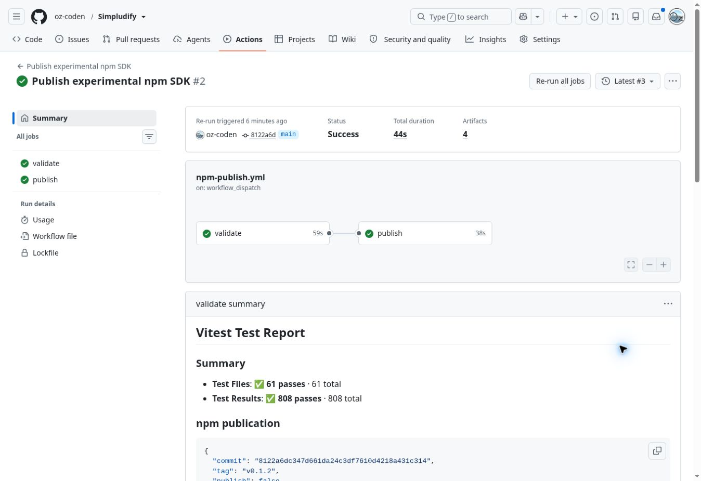

# v0.1.2 publication and registry adoption

## Release identity

- Approved source: `8122a6dc347d661da24c3df7610d4218a431c314`, tag `v0.1.2`.
- Tag created by [41408337257](https://github.com/oz-coden/Simpludify/actions/runs/41408337257), checking exact main and successful main CI before creating an immutable lightweight tag.
- Publication: [Trusted Publishing 41408637470](https://github.com/oz-coden/Simpludify/actions/runs/41408637470), manually dispatched from the approved main with exact package/version confirmation.
- Core accepted at 16:49 JST, Web at 16:53 JST. Both signed provenance and were accepted using OIDC. npm's processing exceeded the one-minute metadata-visibility budget, stopping each attempt before proceeding. Existing versions were subsequently verified and skipped only when their integrity matched the identical saved archive. Registry metadata later confirmed both v0.1.2 versions.
- npm's website presented this cloud browser with a persistent Cloudflare verification page, so authenticated package-settings inspection was unavailable. The existing Trusted Publishing identity was retained; the successful OIDC publication is the operational verification.

## Integrity

- Core: `sha512-luTI8hjX+sJ/IKu2RXpE16BI+UqE97mtT0Ql3LCvvb5lQLnJY2aIK5hdSi344fBYz1bIS2FPz42MpUAb9LcEgw==`.
- Web: `sha512-GxJqLvSU2af5MXf6W8aiUzo9zXLi4eYHWM/hIEIfNwvEyJggOyTyhFfQEht0cGoleeKS8yzI9VSPECPfcRwnXA==`.

Both match the approved source archives. The release tag is not moved when documentation or the starter changes afterward.

## Follow-up changes and checkpoint

- Publish visibility polling now permits six minutes for npm processing, rather than assuming visibility within one minute. The artifact and integrity guards remain intact. This change applies to future workflows; the actual v0.1.2 release remains the approved immutable source above.
- README, npm guide and consumer patterns describe published v0.1.2.
- The independent starter installs Web v0.1.2 with a registry-generated lockfile and uses bindViewport for the HUD/world split. Its acceptance script derives version checks from metadata.
- Clean public-registry consumers and resumed publish workflow are in progress. Full CI and post-update Pages acceptance are pending at this checkpoint.
- Preserve the prior [release validation record](https://github.com/oz-coden/Simpludify/blob/1224fa224d23b98737ee5872412383b39aff4436/docs/work-reports/2026-11-02-v0.1.2-release.md), including Chromium 153 Canvas2D timeout results. Normal Playwright Chromium regression remains enabled.

## Registry verification checkpoint

Attempt 3 of the original publication run succeeded. The resumed job verified both already-published archives as identical and passed the public-registry clean consumer suite, including bindViewport, declarations, CSS, Scene replacement and disposal. The exact release source and tag remained unchanged. Local follow-up quality checks and all 808 unit tests passed. Starter and integration PR validation follows.

